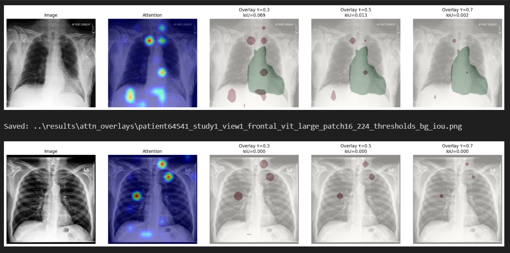

# Vision Transformer Attention Visualization

A notebook exploring attention-map visualization and localization evaluation for chest X-ray images using a pretrained Vision Transformer.

## Why this project matters

Inspecting model attention can help generate hypotheses about image regions involved in a prediction. Comparing overlays with annotations encourages evaluation beyond an appealing heatmap.

## What is implemented

- Pretrained `vit_base_patch16_224` loading through timm
- Attention extraction and spatial heatmap construction
- Overlay generation
- Dataset configuration for CheXlocalize, CSV bounding boxes, or mask directories
- Threshold-based intersection-over-union evaluation

Despite the repository name, the inspected notebook uses a pretrained model; it does not train a Vision Transformer from scratch.

## Run locally

```bash
git clone https://github.com/Arjun1443/Vision-transformers-from-scratch.git
cd Vision-transformers-from-scratch
python -m pip install torch timm numpy pandas pillow matplotlib jupyter
python -m jupyter notebook
```

Open [ViTX_Demo.ipynb](ViTX_Demo.ipynb). Update the `CFG` dataset and output paths before running. The configured CheXlocalize sample path and image annotations are not bundled in this repository. Pretrained weights may require a download.

## Visual overview




## Technical focus

PyTorch · timm · Vision Transformers · attention hooks · visualization · localization metrics

## Interpretation

Attention is not proof of causal explanation or clinical localization accuracy. Report the dataset, annotation method, threshold, and held-out evaluation when discussing IoU. This is a research demonstration, not a diagnostic system. timm version changes can affect attention extraction behavior.
